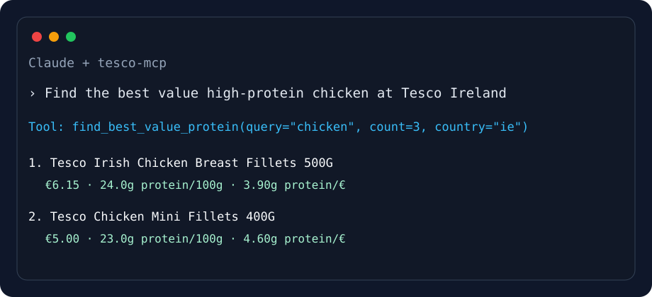

# 🛒 Tesco MCP — AI-powered grocery shopping for Tesco IE & UK

[](https://www.python.org/)
[](https://modelcontextprotocol.io/)
[](LICENSE)
[](https://github.com/conormongan/tesco-mcp/actions/workflows/ci.yml)

Search Tesco products, compare prices, check promotions, and inspect per-100g nutrition — directly from Claude, OpenClaw, or any MCP client.

> ✨ Nutrition-first: Tesco MCP extracts calories, protein, carbs, fat, fibre, sugar, and salt per 100g. That makes it useful for meal planning, macro tracking, and value-for-protein shopping — a gap most grocery MCP servers do not cover.



## What it can do

Ask your AI assistant things like:

- “Find high-protein yoghurts at Tesco Ireland and sort by protein per euro.”
- “Compare chicken breast products by price and calories.”
- “Get the nutrition for Tesco product TPNB `123456789`.”
- “Search Tesco UK for oats and show promotions.”

The server uses Tesco’s public web APIs:

1. `search.api.tesco.com` to find product IDs (`TPNBs`)
2. `xapi.tesco.com` GraphQL to hydrate full product details

No scraping. No browser automation. No Tesco account.

## No auth required

Tesco MCP does not require a Tesco login, session cookie, or user-provided API key. It uses public endpoints and the public API key embedded in Tesco’s own frontend JavaScript.

## Installation

```bash
pip install tesco-mcp
```

Or run directly with `uvx`:

```bash
uvx tesco-mcp
```

For local development from a clone:

```bash
git clone https://github.com/conormongan/tesco-mcp.git
cd tesco-mcp
python -m venv .venv
source .venv/bin/activate
pip install -e '.[dev]'
pytest
```

## MCP client setup

### Claude Desktop

Add this to your Claude Desktop config:

```json
{
  "mcpServers": {
    "tesco": {
      "command": "uvx",
      "args": ["tesco-mcp"]
    }
  }
}
```

If installed with `pip`, use:

```json
{
  "mcpServers": {
    "tesco": {
      "command": "tesco-mcp"
    }
  }
}
```

### Claude Code

```bash
claude mcp add tesco -- uvx tesco-mcp
```

### OpenClaw

Add a stdio MCP server entry using `uvx tesco-mcp`, or run the module directly from a checkout:

```bash
python -m tesco_mcp.server
```

## Available tools

| Tool | Purpose | Key parameters |
| --- | --- | --- |
| `search_products` | Search Tesco groceries by name and return price, nutrition, promotions, pack size | `query`, `count`, `country` |
| `get_product` | Get full product details by TPNB ID | `tpnb`, `country` |
| `get_nutrition` | Get per-100g nutrition for one product | `tpnb`, `country` |
| `compare_products` | Compare multiple products side-by-side by price and nutrition | `query`, `count`, `sort_by`, `country` |
| `find_best_value_protein` | Sort products by protein grams per unit of currency | `query`, `count`, `country` |
| `get_promotions` | Find products with active promotions/deals | `query`, `count`, `country` |
| `find_alternatives` | Find cheaper alternatives with savings breakdown | `product_name`, `count`, `country` |
| `meal_cost_calculator` | Estimate meal cost from a list of ingredients | `ingredients` (comma-separated), `country` |
| `weekly_shop_estimator` | Estimate weekly shop cost with quantities | `items` (e.g. "chicken x2, rice x1"), `country` |

`compare_products.sort_by` supports:

- `price` — lowest shelf price first
- `protein` — highest protein per 100g first
- `calories` — lowest calories per 100g first
- `protein_per_euro` — highest protein per euro/pound first

## Country support

| Country | Code | Currency | Notes |
| --- | --- | --- | --- |
| Ireland | `ie` | EUR | Default |
| United Kingdom | `uk` | GBP | Uses UK region/language headers |

The country configuration is isolated in `tesco_mcp.tesco_api.COUNTRIES`, so adding more Tesco regions later should be straightforward.

## Example responses

### `search_products(query="rolled oats", count=2, country="ie")`

```json
{
  "query": "rolled oats",
  "country": "ie",
  "total": 42,
  "products": [
    {
      "tpnb": 123456789,
      "title": "Tesco Porridge Oats 1Kg",
      "price": 1.35,
      "currency": "EUR",
      "pack_size": "1Kg",
      "promotions": [],
      "nutrition": {
        "calories_kcal": 374.0,
        "protein_g": 11.0,
        "carbs_g": 60.0,
        "fat_g": 8.0,
        "fibre_g": 9.0,
        "sugar_g": 1.0,
        "salt_g": 0.01
      }
    }
  ]
}
```

### `find_best_value_protein(query="greek yoghurt", count=5)`

Returns products sorted by `protein_g / price`, useful for nutrition-aware grocery planning.

## Development

```bash
pip install -e '.[dev]'
pytest
python -m tesco_mcp.server
```

The test suite is unit-only by default and uses mocked HTTP responses. It does not hit Tesco live APIs.

## Security: Agent Vault integration

All current tools use **public endpoints** — no authentication required. For future authenticated features (cart, orders, delivery slots), we recommend [Agent Vault](https://github.com/Infisical/agent-vault) by Infisical to broker credentials securely. Your AI agent never sees real session cookies.

See [docs/agent-vault.md](docs/agent-vault.md) for setup instructions.

## Project status

Early open-source release. The Tesco APIs are public but undocumented, so response shapes may change. Failures should be explicit rather than silent; please open an issue with the product query and country code if something breaks.

## License

MIT — see [LICENSE](LICENSE).
